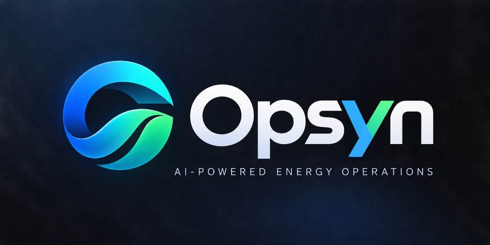
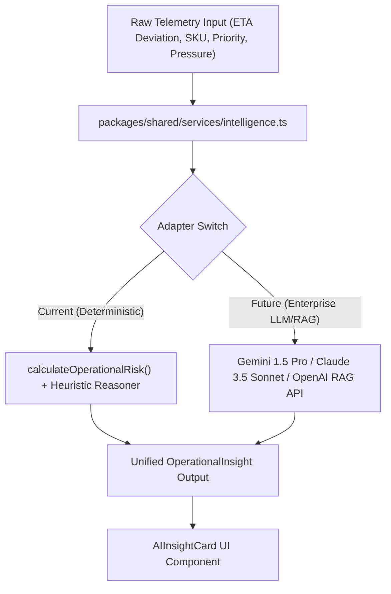

<p align="center">
  
</p>

<p align="center">
  An independent multi-application energy logistics and command system engineered for high-criticality industrial operations.
</p>

<p align="center">
  
  
  
  
</p>


> [!IMPORTANT]
> **Independent Portfolio Implementation Disclosure:**  
> Opsyn is an independent portfolio implementation inspired by an operational multi-app technical specification. It is not a production system of any external company.


## Overview

**Opsyn** is a modern, unified multi-application energy operations platform built with **React Native**, **Expo**, **TypeScript**, and **TanStack Query** within a clean **npm-workspaces monorepo**.

Designed for high-reliability energy logistics such as cryogenic bio-LNG, pressurized biomethane, industrial steam manifold valves, and high-purity hydrogen cascades Opsyn unifies three interconnected operational viewpoints into a single, cohesive codebase:

1. **Opsyn Customer** (`apps/customer`): Enables industrial facility managers to track active consignments, inspect cryogenic telemetry notes, view interactive delivery timelines, and verify digital manifests.
2. **Opsyn Driver** (`apps/driver`): Empowers tanker and transport operators with sequential stop manifests, GPS navigation, and dynamic delivery lifecycle transitions (**Pending → In Transit → Delivered**).
3. **Opsyn Operations** (`apps/operations`): A high-information-density Command Center for operations controllers featuring real-time radar telemetry, anomaly queues, and the **Opsyn Intelligence Engine** for automated risk synthesis and mitigation planning.


## Problem

Industrial energy logistics carries high operational risk:
- **Time & Pressure Sensitivity**: Cryogenic gases (such as Bio-LNG at -162°C) experience boil-off pressure buildup during unexpected transit delays.
- **Fragmented Codebases**: Multi-stakeholder systems frequently suffer from "app drift" where customer, driver, and internal admin applications duplicate models, drift in design language, and desynchronize API contracts over successive development sprints.
- **Static Decision Making**: Traditional operations portals provide static alerts without synthesizing telemetry signals (corridor traffic, pressure, transit duration, order priority) into immediate, actionable recommendations.


## Solution

Opsyn resolves these challenges by establishing:
- **Strict Monorepo Hygiene**: 100% centralized TypeScript types, a single resilient API client, shared design tokens matching the Opsyn visual identity, and **one unified, polymorphic `<OrderCard />` component** reused across all three applications.
- **Deterministic AI Architecture**: An extensible **Opsyn Intelligence Engine** that processes multi-dimensional telemetry (ETA deviations, boil-off rates, hazard classifications) to output risk scores, potential root causes, and protocol recommendations without hallucination.
- **Real-Time Cross-App State Synchronization**: Mutual state updates across the fleet powered by TanStack Query and an idempotency-key write protocol.


## Key Features

- **Polymorphic `<OrderCard />`**: One foundational card component supporting three distinct operational perspectives (`customer`, `driver`, `operations`) with composable named slots and render-props.
- **Opsyn Intelligence Engine**: Deterministic telemetry synthesis producing risk levels (`CRITICAL`, `HIGH`, `MEDIUM`, `LOW`), confidence indices, potential causes, and supporting signal telemetry chips.
- **Dynamic Delivery Lifecycle**: Real-time stop status mutations (`Pending` → `In Transit` → `Delivered`) with immediate cache invalidation and UI reactivity.
- **Resilient API Architecture**: Typed HTTP client featuring abort-on-unmount signals, timeout guards, standardized error envelopes, and automated offline fallback during field demonstrations.
- **Precision Currency Formatting**: Strict Indian numbering locale conversion (`12345600` paise → `₹1,23,456`).
- **Dark Industrial Command Center Theme**: High-contrast obsidian, electric cyan (`#00D2FF`), and energy emerald (`#10B981`) palette extracted directly from the Opsyn emblem.


## Applications

### 1. Opsyn Customer (`apps/customer`)
- **Primary Screen**: *Today's Orders*
- **Header**: Opsyn Logo mark, system status pill, date header (`Thu, 8 Oct 2026`).
- **Summary Metrics**: Total Orders, Delivered, In Transit, Total Value (`formatCurrency`).
- **Interaction**: Multi-filter pills (`ALL`, `IN_TRANSIT`, `DELIVERED`, `DELAYED`, `PENDING`), instant search, and order detail navigation.
- **Detail Screen**: Manifest specifications, delivery address, carrier contact, operational notes, and interactive delivery timeline.

### 2. Opsyn Driver (`apps/driver`)
- **Primary Screen**: *Today's Trip*
- **Trip Banner**: Active vehicle ID (`TS-08-EN-5092 Cryo-Tanker IV`), estimated completion time, cryo-pressure (4.2 Bar), and fuel telemetry (78%).
- **Stop Progress**: Visual `ProgressIndicator` tracking completed vs. remaining stops.
- **Interaction**: Tapping any stop opens *Stop Details*.
- **Dynamic Mutation**: One-tap progression through **Pending → In Transit → Delivered** with live feedback and timestamp logging.

### 3. Opsyn Operations (`apps/operations`)
- **Primary Screen**: *Operations Command Center* (Showcase Screen)
- **High-Level KPIs**: Active Deliveries, Delayed Deliveries, Pending Actions, Critical/High Exceptions.
- **Radar Telemetry**: Live mesh banner tracking regional industrial energy corridors.
- **Priority Filter**: Filter queue by `ALL`, `CRITICAL`, `HIGH`, `MEDIUM`, `LOW`.
- **Detail Screen**: Comprehensive incident view with cryogenic tank pressure sensors, boil-off rate indicators, and traffic congestion indices.
- **Opsyn Intelligence**: One-click **"Generate AI Insight"** triggers an animated telemetry scanning state (`Analyzing operational data...`), revealing risk level, root cause analysis, and protocol actions.


## AI / Intelligence Layer

Opsyn adopts an enterprise-grade AI architecture separating operational reasoning from external infrastructure:



### Deterministic Local Intelligence Engine
- **Interface**: `generateOperationalInsight(data: OperationalInsightInput): Promise<OperationalInsight>`
- **No Mock Hallucinations**: When no cloud LLM API key is present, Opsyn utilizes a local deterministic inference engine evaluating:
  - ETA deviation thresholds (`>10m`, `>20m`, `>30m`, `>60m`)
  - Order priority weighting (`CRITICAL` multiplier)
  - Cargo physical properties (Cryogenic boil-off margin vs. high-pressure cascade)
- **Extensibility**: When an external LLM/RAG backend is attached, consumers invoke the exact same contract without code modifications.


## Technology Stack

- **Framework**: React Native 0.74.5 / Expo SDK 51 (LTS)
- **Monorepo**: npm workspaces
- **Language**: TypeScript 5.3+ (Strict Mode)
- **Navigation**: React Navigation 6 (Native Stack)
- **Server State**: TanStack React Query v5
- **Mock API**: Express / json-server compatible engine with live PATCH persistence
- **Testing**: Vitest 1.6+
- **Icons**: Expo Vector Icons (`Feather`, `MaterialCommunityIcons`, `Ionicons`)
- **Theme**: Custom Design System (`@opsyn/shared/theme`)


## Monorepo Structure

```
opsyn/
│
├── apps/
│   ├── customer/                      # Opsyn Customer App
│   │   ├── src/screens/               # CustomerOrdersScreen, OrderDetailsScreen
│   │   ├── src/navigation/            # RootNavigator (Native Stack)
│   │   ├── App.tsx                    # QueryClientProvider & NavigationContainer
│   │   ├── metro.config.js            # Monorepo Metro resolution
│   │   └── package.json
│   │
│   ├── driver/                        # Opsyn Driver App
│   │   ├── src/screens/               # DriverTripScreen, StopDetailsScreen
│   │   ├── src/navigation/            # RootNavigator
│   │   ├── App.tsx
│   │   ├── metro.config.js
│   │   └── package.json
│   │
│   └── operations/                    # Opsyn Operations Command Center
│       ├── src/screens/               # OperationsCommandScreen, OperationalIssueDetailScreen
│       ├── src/navigation/            # RootNavigator
│       ├── App.tsx
│       ├── metro.config.js
│       └── package.json
│
├── packages/
│   └── shared/                        # Centralized Shared Core
│       ├── assets/                    # opsyn-logo.png
│       ├── src/
│       │   ├── api/                   # Resilient typed ApiClient & TanStack hooks
│       │   ├── components/            # Polymorphic OrderCard, Badges, Timeline, AIInsightCard
│       │   ├── services/              # Opsyn Intelligence Engine
│       │   ├── theme/                 # Obsidian energy tokens, colors, typography
│       │   ├── types/                 # Central TypeScript interfaces (Order, Trip, Action)
│       │   └── utils/                 # Currency formatting (paise -> INR), dateTime
│       ├── tests/                     # Vitest unit test suite
│       └── package.json
│
├── mock-api.json                      # Realistic industrial energy operational dataset
├── server.js                          # Resilient Mock API server with CORS & PATCH support
├── vitest.config.ts                   # Unit test configuration
├── package.json                       # Monorepo workspaces & root scripts
├── tsconfig.json
├── .gitignore
├── .env.example
└── README.md
```


## API Architecture

Located at `packages/shared/src/api/client.ts`, the shared `ApiClient`:
- **Single Source of Truth**: All three apps consume the exact same client instance.
- **Signal Abort**: Automatically chains `AbortController` signals to cancel inflight requests upon screen unmount.
- **Timeout Management**: Built-in 8000ms request timeout guard with `REQUEST_ABORTED` error mapping.
- **Idempotency-Key Protocol**: Automatically generates and attaches an `Idempotency-Key` header (`opsyn-idemp-<timestamp>-<hash>`) to mutating HTTP calls (`POST`, `PUT`, `PATCH`).
- **Resilient Field Fallback**: If running in an offline environment or if the mock server hasn't been booted, the client transparently serves local demo data so live presentations never crash.

### Endpoints
- `GET /orders?customerId={id}` - Customer consignments
- `GET /orders/:id` - Single order manifest
- `GET /trips?driverId={id}` - Driver trip with stops
- `PATCH /trips/:tripId/stops/:stopId` - Live stop lifecycle transition
- `GET /pending-actions?adminId={id}` - Operations queue items
- `GET /pending-actions/:id` - Detailed operational anomaly


## Shared Component Architecture

### The Polymorphic `<OrderCard />`
Per specification requirement R4, **ONE** polymorphic component serves all three applications via the `mode` prop:

```tsx
// Customer Mode (Focus: Amount, SKU, Delivery Window)
<OrderCard
  mode="customer"
  id={order.id}
  title={order.customerName}
  subtitle={order.deliveryAddress}
  status={order.status}
  amountInPaise={order.amountInPaise}
  sku={order.sku}
  eta={order.currentEta}
  onPress={() => navigate('OrderDetails', { orderId: order.id })}
/>

// Driver Mode (Focus: Stop Sequence, Address Truncation, Cargo SKU)
<OrderCard
  mode="driver"
  id={stop.id}
  orderId={stop.orderId}
  stopNumber={index + 1}
  title={stop.customerName}
  address={stop.address}
  status={stop.status}
  sku={stop.sku}
  eta={stop.eta}
  onPress={() => navigate('StopDetails', { stopId: stop.id })}
/>

// Operations Mode (Focus: Anomaly Issue, Priority, Schedule Deviation Alert)
<OrderCard
  mode="operations"
  id={action.id}
  orderId={action.orderId}
  title={action.issue}
  subtitle={action.customerName}
  status={action.status}
  priority={action.priority}
  etaDeviationMinutes={action.etaDeviationMinutes}
  eta={action.currentEta}
  onPress={() => navigate('OperationalIssueDetail', { actionId: action.id })}
/>
```


## Setup

### Prerequisites
- **Node.js**: v18.0.0 or later (v20+ recommended)
- **npm**: v9.0.0 or later
- **Expo Go App**: Installed on physical Android phone (from Google Play Store)

### 1. Install Dependencies
```bash
npm run install:all
```


## Running the Mock API

Start the local energy operations server on port 4000:
```bash
npm run api
```
Output:
```
==================================================
 OPSYN MOCK API SERVER READY
 Running on: http://localhost:4000
 Network access: http://0.0.0.0:4000
 Endpoints:
   GET   /orders?customerId=CUST-101
   GET   /trips?driverId=DRV-301
   PATCH /trips/:tripId/stops/:stopId
   GET   /pending-actions?adminId=OPS-001
==================================================
```


## Running the Applications

Each app can be run independently using dedicated root scripts:

### Running Customer
```bash
npm run customer
```

### Running Driver
```bash
npm run driver
```

### Running Operations
```bash
npm run operations
```


## Running on Android with Expo Go

1. Connect your Android phone and computer to the **same Wi-Fi network**.
2. Run any of the applications (e.g. `npm run operations`).
3. Metro bundler will display an interactive terminal with a large **QR Code**.
4. Open **Expo Go** on your Android phone and tap **"Scan QR code"**.
5. The JavaScript bundle will compile and launch the application directly on your phone.


## LAN Mode vs Tunnel Mode

### LAN Mode (Default)
By default, Expo runs in LAN mode.  
To ensure your phone connects to your computer's mock API server when using LAN mode, set your local IP in your environment or `.env`:
```env
EXPO_PUBLIC_API_URL=http://<YOUR_COMPUTER_LOCAL_IP>:4000
```
*(e.g., `http://192.168.1.15:4000`)*

### Tunnel Mode (For strict firewalls or guest Wi-Fi)
If your computer and mobile phone cannot discover each other over local Wi-Fi, run the apps in **Tunnel Mode**:
```bash
npm run customer:tunnel
npm run driver:tunnel
npm run operations:tunnel
```
Expo will generate a global secure cloud proxy tunnel URL bypassing local subnet restrictions.


## Testing

Run the Vitest test suite covering currency conversion, API error normalization, and the deterministic operational intelligence risk engine:

```bash
npm test
```

### Verified Test Cases:
1. **Currency Formatting**: Verified `12345600 paise` converts to `₹1,23,456` in Indian numbering notation.
2. **Operational Risk Engine**: Verified risk calculation (`LOW` for <=10m delay, `MEDIUM` for moderate delay, `HIGH` for >30m delay with `CRITICAL` priority, and `CRITICAL` for >60m delay).
3. **Resilient API Handling**: Verified offline fallback, request timeout, and mutating idempotency keys.


## Application Demo

Explore the three interconnected applications that make up Opsyn. Each demo highlights the app's core workflows, interface, and role within the energy operations platform.

### 1. Opsyn Customer App

**Purpose:** Enables industrial customers to track consignments, review order details, and monitor delivery progress.

**Key features demonstrated:**
- Today's Orders dashboard and KPI summary
- Order search and status filters
- Consignment manifest and delivery details
- Interactive delivery timeline

**Demo video:** [Watch Opsyn Customer App](https://drive.google.com/file/d/1HPj_PapxADA30cRFNsqki-uST12hPK02/view?usp=drivesdk)

---

### 2. Opsyn Driver App

**Purpose:** Helps drivers manage assigned trips, review delivery stops, and update delivery status.

**Key features demonstrated:**
- Today's Trip dashboard and route progress
- Delivery stop list and stop details
- Delivery lifecycle: Pending → In Transit → Delivered
- Status updates and progress tracking

**Demo video:** [Watch Opsyn Driver App](https://drive.google.com/file/d/12EdIhwXM8zl1gLXWB6-dJGAhzy9axQFF/view?usp=drivesdk)

---

### 3. Opsyn Operations Command Center

**Purpose:** Provides operations teams with a unified view of deliveries, priority issues, telemetry, and operational insights.

**Key features demonstrated:**
- Operational KPI dashboard
- Priority-based issue filtering
- Telemetry and incident details
- Opsyn Intelligence Engine and risk recommendations

**Demo video:** [Watch Opsyn Operations App](https://drive.google.com/file/d/1TgODL4SMqoVnOs6qfYJtmjHSMwwaaIIm/view?usp=drivesdk).

---


## Engineering Decisions & Trade-offs

| Decision | Rationale | Trade-off |
|---|---|---|
| **npm workspaces** | Native to standard Node.js without requiring third-party global binary installations (pnpm/yarn). | Slightly slower cold install compared to pnpm, but universally reproducible on any machine. |
| **Polymorphic `<OrderCard />`** | Strictly adheres to DRY and specification requirement R4. Prevents component drift. | Prop interface requires careful union types (`OrderCardMode`), solved using composable slots. |
| **Deterministic Intelligence Engine** | Guarantees reliable, un-hallucinated responses during live interviews and demos. | Does not generate free-form conversational text; designed with a swappable interface for future LLM integration. |
| **Resilient API Client Fallback** | Ensures the demo app never shows an unhandled white-screen crash if the mock server is offline. | Must keep in-memory mock data synchronized with the root `mock-api.json`. |


## Future Improvements

- **Phase 2 Payment Integration**: Wire Razorpay / industrial escrow billing into the Customer app.
- **Live WebSocket Telemetry**: Stream continuous GPS and pressure sensor pings rather than 30s polling intervals.
- **RAG LLM Connection**: Connect the `generateOperationalInsight` interface to a vector database indexing facility SOPs and hazardous materials compliance guidelines.
- **Offline SQLite Cache**: Implement local SQLite storage for drivers traveling through zero-connectivity rural transit zones.


## AI Usage Disclosure

- **AI Tools Used**: Gemini 3.8 Flash (High) via Antigravity Pair Programming.
- **Files Generated**: Monorepo scaffolding, TypeScript type definitions, polymorphic components, design system tokens, and intelligence reasoning algorithms.
- **Engineering Review**: All business logic, Indian currency regex calculations, and React Query cache mutations were reviewed and verified.

---

*Opsyn: AI-Powered Energy Operations Platform · 2026*
